# hyprdots

My Arch Linux desktop, built around **Hyprland, Noctalia, Lua, and chezmoi**. Hyprland handles windows and input, Noctalia provides the shell, and the configs are split into files I can find and change without digging through the whole setup.

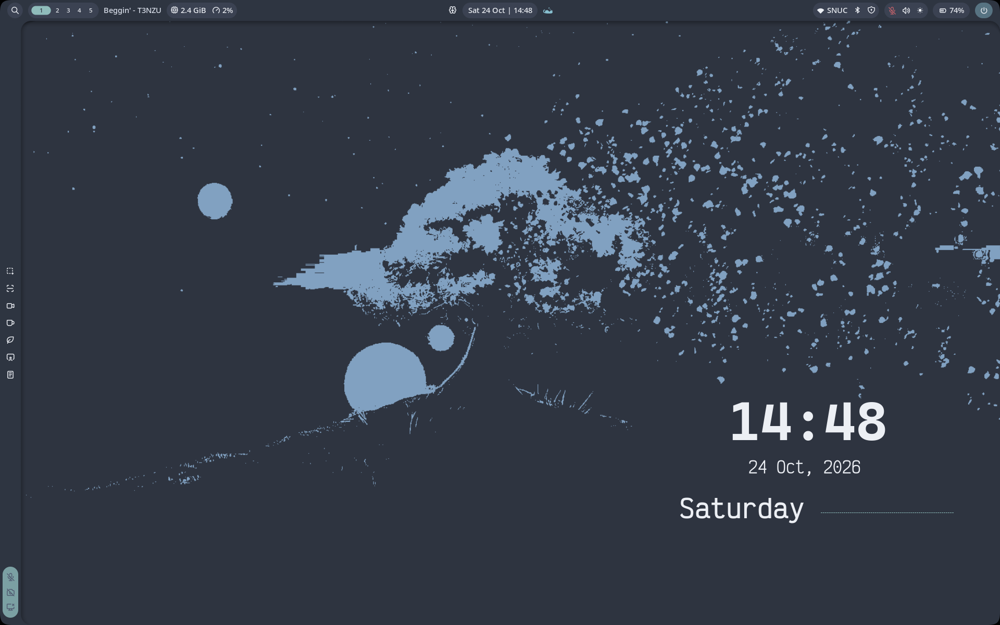

This is my daily configuration. Some paths and application choices are personal, so read the scripts and preview `chezmoi diff` before applying it to another machine. Run the installer as your normal user.

Last checked against the local setup on **26 November 2026**, with **Hyprland 0.57.2** and **Noctalia 5.6.0** installed. Screenshots show earlier states of the desktop, mostly Nord. The existing images are kept as placeholders until I replace them.

## Contents

- [Features](#features)
- [Installation](#installation)
- [First login](#first-login)
- [Profiles and theming](#profiles-and-theming)
- [Hyprland](#hyprland)
- [Keybindings](#keybindings)
- [Noctalia](#noctalia)
- [Terminals](#terminals)
- [Neovim](#neovim)
- [Fish and Starship](#fish-and-starship)
- [Music](#music)
- [Other tools](#other-tools)
- [Dotfiles workflow](#dotfiles-workflow)
- [Repository layout](#repository-layout)
- [Troubleshooting](#troubleshooting)
- [Current limits](#current-limits)
- [Security](#security)

## Features

- Lua-based Hyprland config with core defaults, personal overrides, and shared libraries.
- Application records shared by launch shortcuts and floating-window rules.
- Binding IDs for remapping, disabling, or replacing shortcuts without copying every field.
- Workspace groups, special workspaces, placement presets, and four layouts.
- Noctalia panels for wallpapers, notes, focus timing, recording, OCR, and other desktop controls.
- Four profiles: **Malachite** (current default), **Nord**, **Black**, and **Foresto**.
- Profile switching with locking, palette verification, file snapshots, and recovery.
- Kitty and Foot, Fish with Starship, and Neovim built on LazyVim.
- MPD/rmpc configuration on the client side, CAVA, and desktop media controls.
- chezmoi deployment, package manifests, and an installer that attempts to back up replaced configs.

## Installation

### Requirements

- Arch Linux or an Arch-based system with pacman.
- A normal user with sudo access and working networking.
- Current Hyprland and Noctalia packages compatible with the documented setup.
- Python **3.11+** for the profile helper, and `flock` from util-linux.
- The repository at **`~/.dotfiles`**.

The installer still checks for Hyprland **0.55.0**, the first Lua-config release. The current code uses newer APIs; passing that old check does not establish compatibility. Python is required by the profile scripts but is not explicitly listed in the desktop package manifest.

> [!WARNING]
> The installer runs a full `sudo pacman -Syu`, installs packages, offers service changes, and applies configuration. It is not just a theme installer.

### Clone and review

```bash
git clone https://github.com/cobra-r9/hyprdots-0.git ~/.dotfiles
cd ~/.dotfiles
less install.sh
cat packages/arch-desktop.txt
cat packages/aur-optional.txt
```

Keep an existing `~/.dotfiles` checkout intact until you have reviewed it. The installer expects that location.

### Run

```bash
./install.sh
```

The script checks the system, upgrades packages, installs the manifests, creates user directories, offers service setup, adapts home paths, previews chezmoi changes, and applies the configs. It can also offer to set Fish as the login shell.

| Option | Effect |
| --- | --- |
| `--with-aur` | Offers optional appearance packages using an existing yay or paru |
| `--yes` | Accepts installer prompts; still prints the diff |
| `--no-services` | Skips the service block, including the MPD user-service attempt |

Installer backups go under `~/.local/state/hyprdots/backup-*.tar.gz`. Declining the final config apply does not undo earlier package or service changes.

If your home differs from `/home/rev`, the installer rewrites matching paths under `dots/` and `profiles/`. That changes the checkout itself.

The final `hyprctl reload` is unconditional. Outside a running Hyprland session it can fail after earlier installation steps have completed. Inside a session, check `hyprctl configerrors`; do not assume every reported problem is a stale message.

## First login

1. Start a Hyprland session through your display manager or run `start-hyprland` from a TTY.
2. Confirm Noctalia starts and run `noctalia config validate`.
3. Review the plugin list before enabling anything. `post-install.sh` still contains older plugin choices and does not match the current enabled inventory below.
4. Open Neovim and let its plugin manager finish.
5. Configure your own accounts, MPD library, and any machine-specific services.
6. Press **Super + K** to open the live shortcut viewer.

The Fish TTY helper is stored at `~/.config/fish/auto-Hypr.fish`. The main Fish config does not source it, and Fish does not automatically load arbitrary files from that directory. Source or relocate that logic deliberately if you want automatic TTY startup.

## Profiles and theming

Noctalia generates the application colors. Profiles store the shell settings used to select those colors and the wallpaper.

| Profile | Palette | Saved wallpaper |
| --- | --- | --- |
| `nord` | Built-in Nord | `nord/nord_alone_tree.png` |
| `black` | Monochrome wallpaper palette with pure-black dark surfaces | `black/deer.jpg` |
| `foresto` | Wallpaper-derived tonal-spot palette | `foresto/blush.jpg` |
| `malachite` (default) | Wallpaper-derived tonal-spot palette | `malachite/malachite.jpg` |

Wallpaper paths are relative to `~/Pictures/Wallpapers/`.

**Malachite is the current default.** `profiles/.current` names it, and the managed Noctalia settings use its wallpaper. The profile name comes from the saved settings, not the inactive `theme.builtin = "Nord"` value: `theme.source = "wallpaper"` selects the wallpaper palette.

### Malachite


*Previous desktop image, kept here until I replace it with a Malachite screenshot.*

### Nord

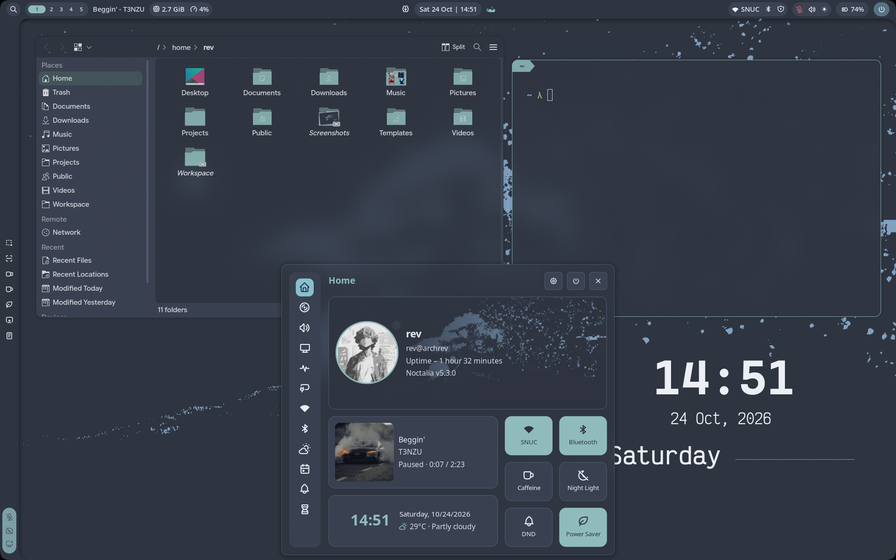

### Black

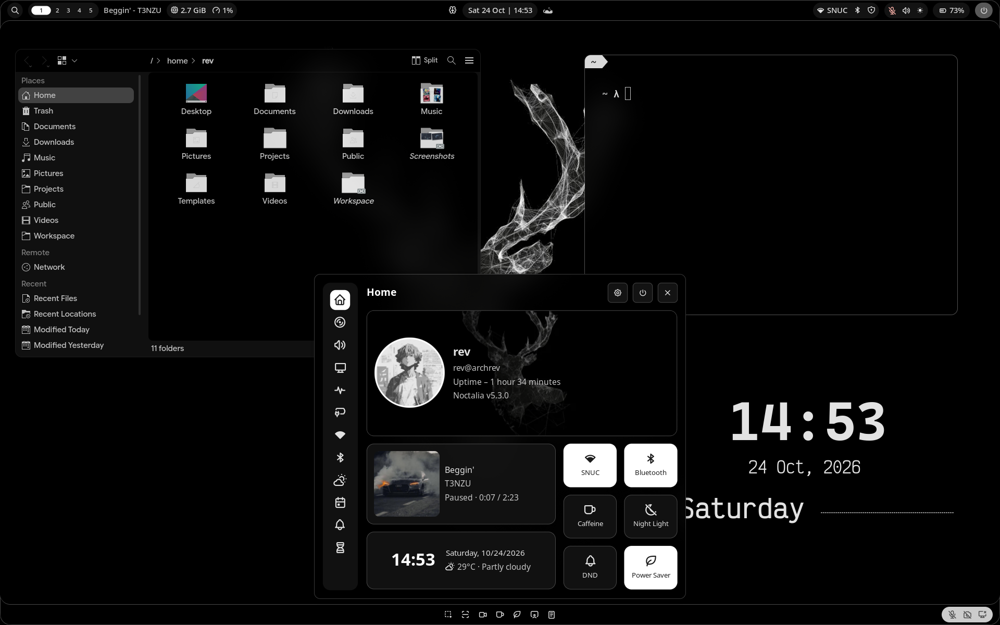

The Black profile also has a Hyprland border override, applied when the generated primary color is white.

### Switch profiles

```bash
~/.dotfiles/scripts/profile-switch
~/.dotfiles/scripts/profile-switch nord
~/.dotfiles/scripts/profile-switch black
~/.dotfiles/scripts/profile-switch foresto
~/.dotfiles/scripts/profile-switch malachite
~/.dotfiles/scripts/profile-switch --list
```

The picker is bound to **Super + Alt + Space**.

The switcher takes a lock, validates the candidate, and snapshots the covered settings/theme files. It copies the profile into place, records `profiles/.current`, asks Noctalia to regenerate, and verifies the expected palette across required app outputs.

Those outputs must agree and settle for three seconds. A generation failure times out after 45 seconds and triggers recovery. On success it reloads/checks Hyprland, runs the optional profile hook, and captures selected live files with chezmoi. A later hook or capture failure is reported as a warning after activation.

Snapshots live in `~/.local/state/hyprdots/backups/switch-*/`, with a manifest and numbered file copies. Ten snapshots are retained. Coverage is defined in `scripts/profile-theme.py`; it is not a backup of everything a third-party template could touch.

**Changing wallpaper directly does not automatically save it into the profile or run `chezmoi add`.** Noctalia updates the live colors, but automatic wallpaper capture has not been installed. The saved profile can therefore differ from your current wallpaper.

Profiles are still complete shell-settings snapshots. Switching appearance can also change plugins and panel preferences.

## Hyprland

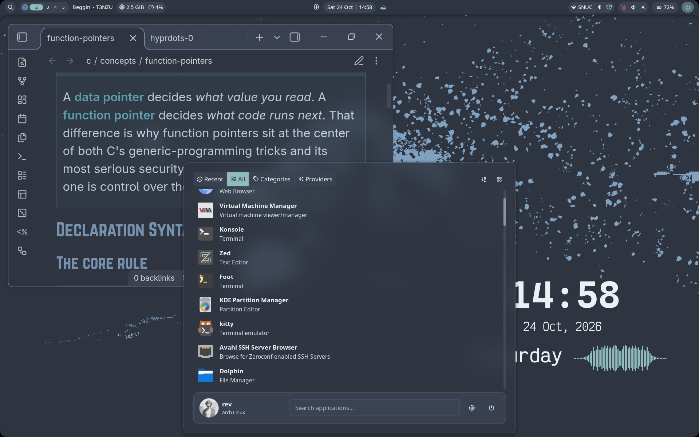

The entry point is `~/.config/hypr/hyprland.lua`. Shared settings load first, ordinary modules apply their matching custom overrides, custom functions are merged before bindings are built, and manual colors apply after Noctalia's generated theme.

### Layouts and workspaces

- Dwindle is the default; F12 cycles scrolling, dwindle, master, and monocle.
- Super + Space toggles dwindle and scrolling.
- Super + digit selects a slot in the current group of ten; 0 means slot 10.
- Ctrl + Super + digit selects a group while preserving the slot.
- Special workspaces hold scratch space, communication apps, and the system monitor.
- Super + Z enters placement mode for halves, quarters, centering, fill, and restore.
- Ctrl + Tab / Ctrl + Shift + Tab cycle grouped windows. Alt + Tab uses general window cycling.

### Customize

For ordinary personal changes, use `~/.config/hypr/custom/`. Core defaults remain editable under `hyprland/`; the recent shared Noctalia panel bindings live there. Do not hand-edit generated `noctalia.lua` for a lasting color change.

| File | Use |
| --- | --- |
| `custom/variables.lua` | Apps, geometry, opacity, gaps, rounding, cursor, shared settings |
| `custom/keybinds.lua` | Add, remap, replace, or disable bindings by ID |
| `custom/functions.lua` | Reusable callbacks |
| `custom/rules.lua` | Window, workspace, and layer rules |
| `custom/input.lua`, `custom/gestures.lua` | Input and gesture settings |
| `custom/decoration.lua`, `custom/animations.lua` | Window appearance and animations |
| `custom/execs.lua` | Session-start commands and event callbacks |
| `custom/colors.lua` | Colors applied after the generated theme |
| `hyprland/lib/` | Implementation of app records, geometry, and registration |

Keybindings no longer belong in `variables.lua`. To remap an existing binding, insert a partial record in the existing custom return table:

```lua
{ id = "terminal", key = "SUPER + ALT + Return" },
```

For a new command:

```lua
{
    id = "mySystemMonitor",
    key = "SUPER + ALT + Y",
    description = "Open system monitor",
    build_action = function()
        return hl.dsp.exec_cmd("kitty -e btop")
    end,
},
```

Keep the file's existing imports and entries. `build_action` constructs the dispatcher at load time; it does not execute the command then. Disable a default with `{ id = "mediaStop", enabled = false }`.

```bash
luac -p ~/.config/hypr/custom/keybinds.lua
hyprctl reload
hyprctl configerrors
hyprctl rollinglog
```

## Keybindings

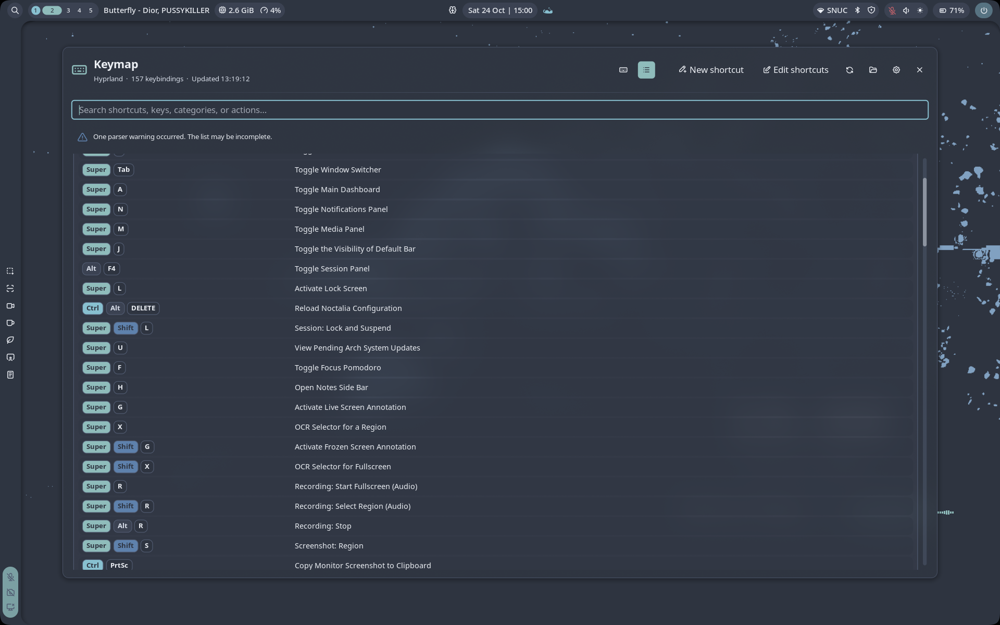

The live viewer is the reference for what actually registered:

```bash
~/.dotfiles/scripts/keybinds.sh --list
```

| Keys | Action |
| --- | --- |
| Super | Launcher |
| Super + Enter | Default terminal |
| Super + B / E / T | Browser / editor / file manager |
| Super + K | Shortcut viewer |
| Super + V | Clipboard history |
| Super + Tab | Window switcher |
| Super + F | Pomodoro heatmap panel |
| Super + H | Notes |
| Super + W | Wallpaper hub |
| Super + Alt + W | Built-in wallpaper picker |
| Super + Shift + W | mpvpaper picker |
| Super + Alt + Shift + W | Wallhaven browser |
| Super + Shift + D | Android Connect |
| Super + ; | Media Downloader |
| Super + Alt + Space | Profile picker |
| Super + Shift + S | Region screenshot |
| Super + X | Region OCR |
| Super + G | Live annotation |
| Super + R / Shift + Super + R | Start recording / select region |
| Super + Alt + R | Stop recording |
| Super + L | Lock |
| Super + S / D / Y | Scratch / communication / system-monitor workspace |
| Super + Z | Placement mode |
| Super + Space / F12 | Toggle / cycle layouts |

Media Downloader is currently `SUPER + semicolon`, without Shift. On a US layout, a physical Super + colon combination would be `SUPER + SHIFT + semicolon`.

The first registered shortcut wins a collision. A remapped core binding can recover to its original key after other requested keys have registered, if that original key is free. Check the warning and live viewer after a conflicting remap.

## Noctalia

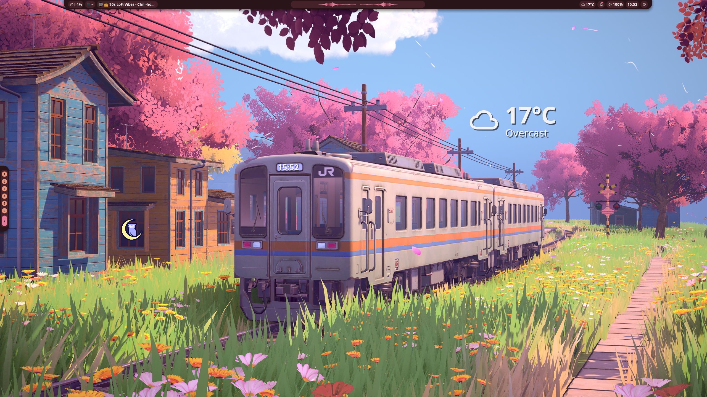

Noctalia provides the bar, launcher, control center, notifications, clipboard, lock screen, wallpaper controls, and desktop widgets. Its templates also carry colors into supported apps.

Authored support configuration is under `~/.config/noctalia/`. Persisted shell settings are in `~/.local/state/noctalia/settings.toml`. The latter can override values from the config directory.

### Current plugins

| Plugin | Purpose |
| --- | --- |
| `fel/ocr` | Screen text recognition |
| `yuuto/arch-updater` | Arch package updates |
| `jamesfeeder/special-workspaces` | Special-workspace indicators |
| `andrewdems/vpn-manager` | NetworkManager and VPN controls |
| `h-jangra/region-recorder` | Region and fullscreen recording |
| `noctalia/notes` | Notes panel |
| `aristides/udiskie` | Removable-media integration |
| `demencia89/androidconnect` | Android device integration |
| `cero800/arch-audit` | Arch package security information |
| `omerfuyar/media-downloader` | Media downloads |
| `adam-gassem/pomodoro-heatmap` | Focus timer and activity heatmap |
| `noctalia/mpvpaper` | Animated wallpaper picker |
| `noctalia/wallhaven` | Wallhaven wallpaper browser |
| `ashur-d/wallpaper-widget` | Wallpaper hub |


`post-install.sh` has not caught up with that list. It still references the old Pomodoro and deprecated keymap plugin, and omits newer panels. Review/update its list before using it on another installation.

```bash
noctalia msg plugins list
noctalia msg plugins enable noctalia/wallhaven
noctalia config validate
```

The Super + K viewer uses the repository script and Fuzzel. It does not depend on the old keymap plugin.

### Theme integrations

Starship is selected as a **community** template. Fastfetch's installed hook requires strict JSON, so the current `config.jsonc` intentionally has no comments or trailing commas.

The custom Obsidian template targets the configured vault explicitly. Its input uses resolved paths rather than `/home/$USER/`, which Noctalia treated literally. If you move the vault, update the template output path and the profile script's vault setting together.

## Terminals

### Kitty

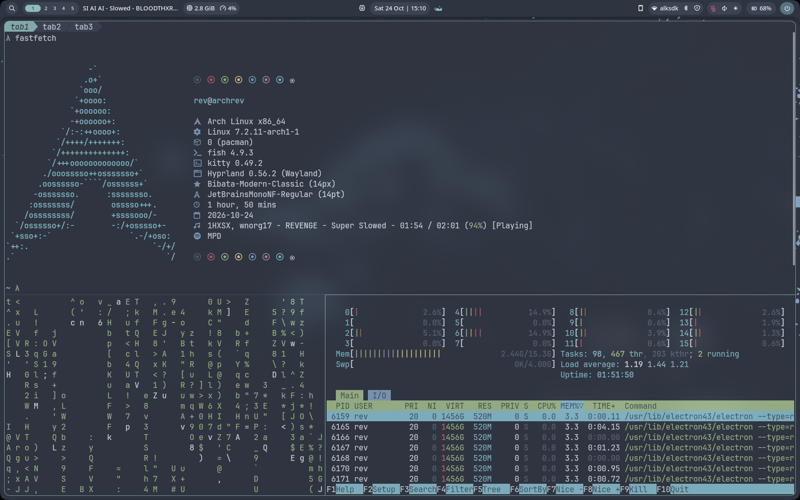

Kitty is the default, with Fish, Noctalia colors, tabs, splits, and a search helper. Alt + Enter opens a tab, Alt + H/V opens splits, Alt + arrows moves between panes, and Ctrl + F searches output.

Edit behavior in `kitty.conf`; the included `themes/noctalia.conf` is generated.

### Foot

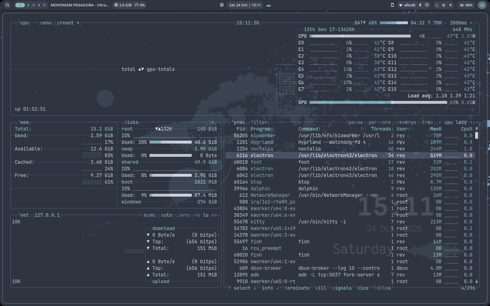

Foot is the alternative, with matching colors and built-in search. It uses Ctrl + C for copy and Ctrl + Shift + C for the interrupt character. Its palette is included from `themes/noctalia`.

Changing `apps.terminal` in the Hyprland variables overrides also changes how terminal-wrapped applications launch.

## Neovim

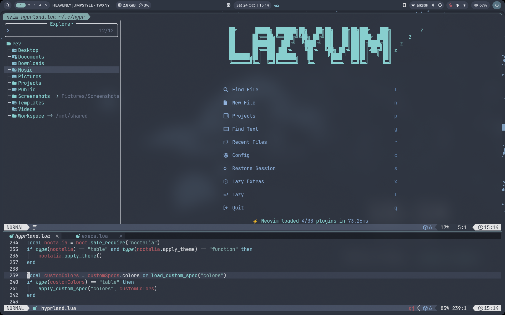

Neovim uses LazyVim and a generated Base16 palette. Plugin settings live in `lua/plugins/`; options, keymaps, and autocommands live in `lua/config/`.

Custom additions include save/quit mappings, man-page pickers with section filters, and starter templates for C and assembly. clangd and LuaLS start normally; Bash and Python servers are configured for on-demand activation. Conform selects clang-format, shfmt, and Black for their corresponding file types.

`lua/matugen.lua` is generated by Noctalia. Its name does not require a separate Matugen daemon. Put persistent editor changes in authored config rather than that generated palette.

## Fish and Starship

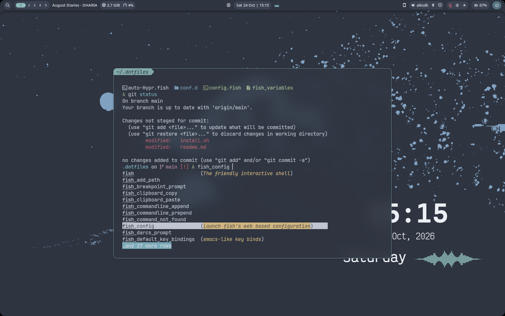

Fish has Starship initialization, eza-based listings, navigation aliases, Git shortcuts, and chezmoi helpers.

`dotsadd` means `chezmoi add`. `dotsapply` means `chezmoi apply`. Neither commits or pushes changes. Keep prompt layout outside Starship's generated palette block.

Some navigation aliases point to my own Workspace paths. Change them for your machine.

## Music

### rmpc and MPD

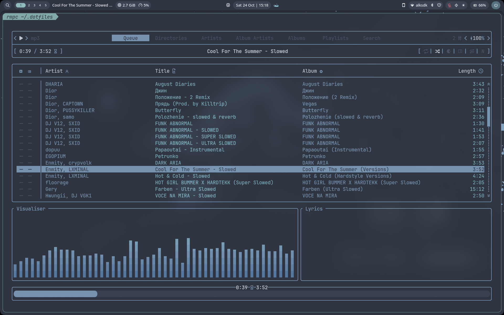

rmpc connects to MPD at `127.0.0.1:6600` and includes lyrics, notifications, album art, and an embedded visualizer. It currently selects its own **Nord** theme; it does not follow the desktop profile.

There is no MPD server config in the managed source tree. Configure your music library, audio outputs, and database separately. The embedded visualizer expects a matching FIFO output at `/tmp/mpd.fifo`.

### CAVA

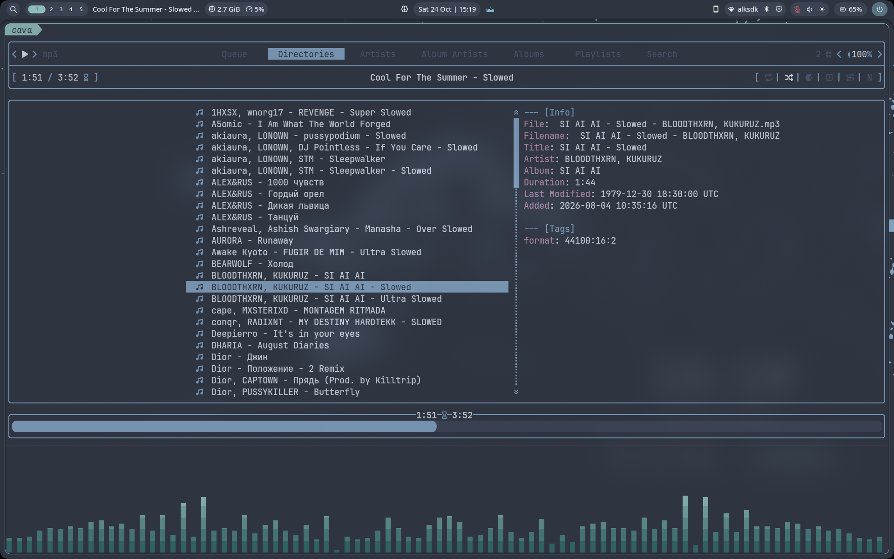

Standalone CAVA has its own config, generated colors, and additional shaders. It is separate from rmpc's embedded visualizer.

## Other tools

### Capture tools

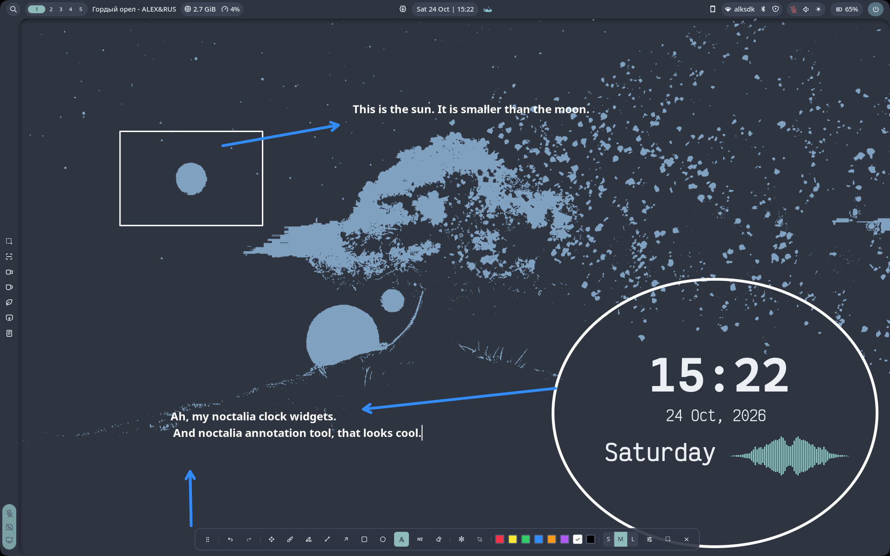

The capture setup uses grim, slurp, Swappy, recording tools, and Tesseract, alongside Noctalia's capture/plugin commands. Confirm the relevant plugin and executable are present when a shortcut does nothing.

### Quick notes

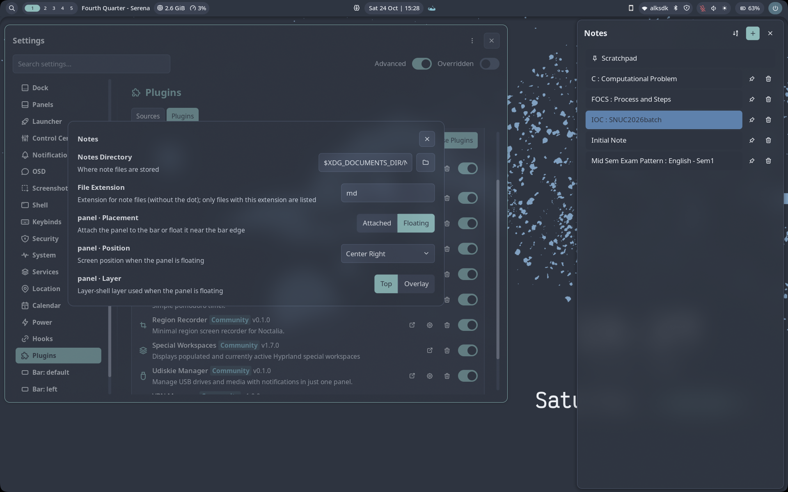

Super + H opens the notes panel. The configured notes directory can be changed to another folder or an Obsidian vault.

### File manager and browser

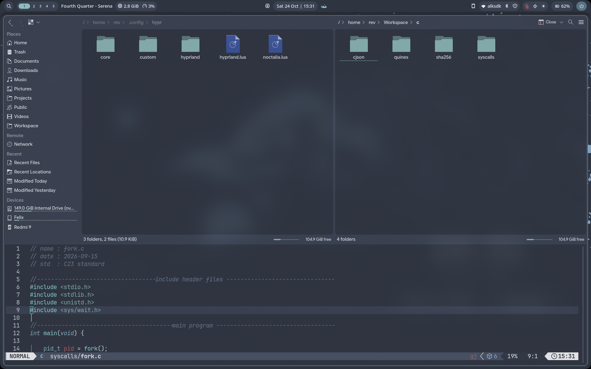

Dolphin is the file manager. Install Konsole separately if you want its embedded terminal integration.

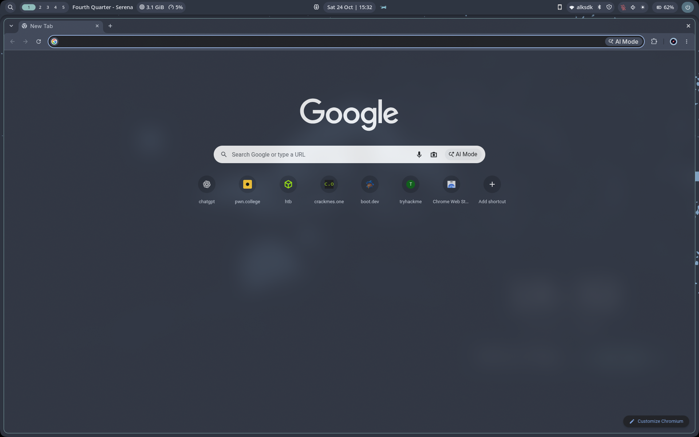

Chromium is the default browser. Changing the Hyprland app record changes its launch shortcut, not every desktop URL association.

## Dotfiles workflow

chezmoi deploys `dots/` into your home directory. `.chezmoiroot` selects that source tree; attributes such as `dot_`, `executable_`, `private_`, and `literal_` control deployed names and permissions.

```bash
chezmoi source-path
chezmoi diff
chezmoi status
```

For a live edit:

```bash
$EDITOR ~/.config/hypr/custom/keybinds.lua
hyprctl reload
hyprctl configerrors
chezmoi add ~/.config/hypr/custom/keybinds.lua
git -C ~/.dotfiles diff -- dots/dot_config/hypr/custom/keybinds.lua
git -C ~/.dotfiles add dots/dot_config/hypr/custom/keybinds.lua
git -C ~/.dotfiles commit -m "Update Hyprland keybindings"
```

`chezmoi apply` deploys source to live files. `chezmoi add` captures live files into source. Git records the source separately. Review generated theme changes before staging them with an unrelated edit.

`scripts/import-wallpapers.sh [directory]` copies new wallpapers into the source collection without replacing existing names. It does not update a changed image that keeps the same filename.

## Repository layout

```text
~/.dotfiles/
├── .chezmoiroot
├── install.sh
├── post-install.sh
├── packages/
│   ├── arch-desktop.txt
│   └── aur-optional.txt
├── profiles/
│   ├── .current
│   ├── nord/
│   ├── black/
│   ├── foresto/
│   └── malachite/
├── scripts/
│   ├── profile-switch
│   ├── profile-theme.py
│   ├── profile-init
│   ├── keybinds.sh
│   └── import-wallpapers.sh
├── tests/
│   └── profile-switch.py
├── dots/
│   ├── dot_config/hypr/
│   ├── dot_config/noctalia/
│   ├── dot_config/nvim/
│   ├── dot_config/fish/
│   ├── dot_config/kitty/
│   ├── dot_config/foot/
│   ├── dot_local/state/noctalia/settings.toml
│   └── Pictures/Wallpapers/
└── assets/
```

## Troubleshooting

| Problem | Check |
| --- | --- |
| Installer cannot find a package | Name and enabled repositories; AUR entries belong in the optional manifest |
| Hyprland will not start | Installed version, live Lua entry point, and the startup log if using the TTY helper |
| Missing Noctalia panel | Run its command directly, list enabled plugins, and inspect Noctalia's log |
| Stale app colors | Generated output, the app's include/config, template-hook errors, and reload behavior |
| Profile switch fails | The verifier's specific error and snapshot location; check its supported palette/mode limits |
| Another switch is running | Let it finish; the lock file's existence alone is not a stuck lock |
| Font fallback | Use `fc-match` for the font named in the app config |
| Keyring asks for a password | Starting GNOME Keyring does not configure PAM to unlock it during TTY login |

```bash
hyprctl configerrors
hyprctl rollinglog
noctalia config validate
noctalia msg plugins list
tail -n 100 ~/.cache/noctalia/noctalia.log
systemctl --user status mpd.service
python3 ~/.dotfiles/tests/profile-switch.py
```

The profile test uses mocks and temporary files; it does not change the running desktop. Nord, Black, and Foresto were tested live during the earlier switcher update. Malachite was checked against its saved, managed, and live wallpaper settings during this documentation update; the switcher was not rerun.

## Current limits

- Profile verification supports explicit dark mode, wallpaper palettes using one palette image across configured monitors, and the built-in Nord anchors. Other modes and palette sources need verifier support first.
- Profiles still replace full shell settings. Direct wallpaper changes do not automatically update profiles or chezmoi.
- Power-saver restoration across reloads and PiP restoration after monitor changes still need work.
- Binding collision detection uses key plus submap, so separate press/release or device restrictions do not make matching records independent.
- The installer's old version gate, unsourced Fish TTY helper, and older post-install plugin inventory remain.
- The current machine's KDE portal routing/backend and ydotool setup are not fully supplied by the standard source/manifests.

## Security

Review scripts, plugins, and AUR build files before enabling them. Commands in startup files and shortcuts run with your user's permissions.

Noctalia settings may contain account or plugin data. Review diffs before sharing or committing them; use `noctalia config export merged --credentials omit` when collecting diagnostics.

Installer archives and profile snapshots are recovery aids, not full system backups.

---

The [wiki](https://github.com/cobra-r9/hyprdots-0/wiki) covers the configuration in more detail and is maintained as a separate Git repository. Updating its local checkout and publishing it are separate steps.

If you spot a discrepancy, open an issue with the relevant config and logs. Suggestions, new profiles, and focused pull requests are welcome.
