# hyprdots

My personal Arch Linux desktop, built around Hyprland, Noctalia, Lua, and chezmoi. I built this setup to be modular enough to tweak without turning every change into a hunt through unrelated config files. Hyprland handles window management, Noctalia handles the desktop shell, and chezmoi keeps the configuration deployed to my home directory in sync with this repository.

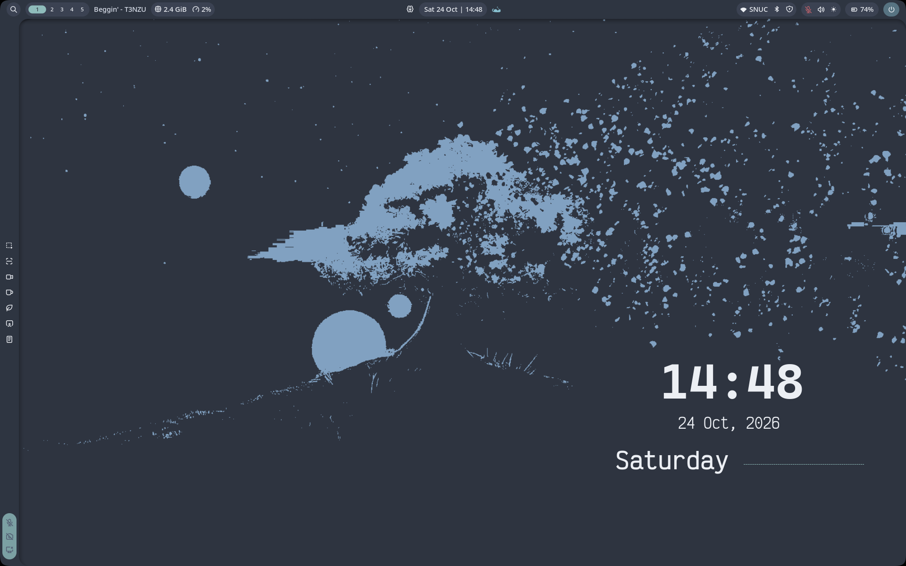


> [!IMPORTANT]
> This is my personal, opinionated setup, not a universal Arch installer. Review the scripts and `chezmoi diff` before applying anything. Run the installer as your normal user, never as root.

## Contents

- [Features](#features)
- [Installation](#installation)
- [First login](#first-login)
- [Profiles and theming](#profiles-and-theming)
- [Hyprland](#hyprland)
- [Keybindings](#keybindings)
- [Noctalia](#noctalia)
- [Terminals](#terminals)
- [Neovim](#neovim)
- [Fish and Starship](#fish-and-starship)
- [Music](#music)
- [Other tools](#other-tools)
- [Dotfiles workflow](#dotfiles-workflow)
- [Repository layout](#repository-layout)
- [Troubleshooting](#troubleshooting)
- [Security](#security)

## Features

- Hyprland configured in Lua, with upstream-style defaults separated from my `custom/` overrides.
- Noctalia for the bar, launcher, notifications, clipboard, wallpapers, lock screen, control center, and desktop widgets.
- Two desktop profiles: `nord` and `black`.
- Profile switching with backups, configuration validation, theme regeneration, and rollback logic.
- Workspace groups, scrolling, dwindle, master and monocle layouts, window groups, and custom window rules.
- Screenshot, screen recording, OCR, and screen annotation shortcuts.
- Kitty and Foot terminals, Fish with Starship, and Neovim with LazyVim.
- MPD, rmpc, CAVA, and desktop media controls.
- chezmoi-based dotfile deployment with an installer that backs up existing managed files before applying changes.

## Installation

### Requirements

- Arch Linux or an Arch-based distribution with `pacman`.
- A regular user with `sudo` access, preferably in the `wheel` group.
- A working internet connection.
- Hyprland **0.55 or newer**, because this configuration uses `hyprland.lua`.
- The repository cloned to **`~/.dotfiles`**. The installer checks this path.

> [!WARNING]
> `install.sh` runs a full `sudo pacman -Syu` before installing the package manifest. This updates the system, not just the packages listed in this repository. Read the script before continuing, especially on a machine that already has a working desktop.

### 1. Clone the repository


```bash
sudo pacman -S --needed git
REPO_URL="https://github.com/dream-wa1ker/hyprdots-0.git"
git clone "$REPO_URL" ~/.dotfiles
cd ~/.dotfiles
```

### 2. Run the installer

```bash
./install.sh
```

The installer checks the system, installs packages from `packages/arch-desktop.txt`, creates user directories, offers to enable relevant services, configures chezmoi, previews the changes, backs up existing managed files, and applies the dotfiles. It also validates the Noctalia configuration and checks the Hyprland version.

Read the proposed `chezmoi diff` before accepting it. Backups of files that are about to be overwritten are saved in `~/.local/state/hyprdots/`.

>[!NOTE]
>If after running the installer script, your hyprland errors, that is probably **stale-error messages** during the applying process. Try running `hyprctl reload`. (Though the installer script does that finally).

### Installer options

| Option | Effect |
| --- | --- |
| `--with-aur` | Offers to install the optional packages in `packages/aur-optional.txt`. Requires `yay` or `paru` to be installed already. |
| `--yes` | Automatically answers yes to installer prompts. The `chezmoi diff` is still printed. |
| `--no-services` | Skips the prompts to enable NetworkManager, Bluetooth, and power-profiles-daemon. |

> [!IMPORTANT]
> The installer rewrites occurrences of `/home/rev/` in files under `dots/` and `profiles/` when your home directory differs. This makes paths match the installing user, but it modifies the checkout itself. `rev` is my username.

## First login

1. Reboot or log out and switch to a TTY.
2. Start Hyprland. The intended setup is to launch it from Fish on `tty1`; if Fish returns to a prompt, start `start-hyprland` manually or wire `auto-Hypr.fish` into Fish startup. But if you have sddm; there is no problem, do not care about that.
3. If hyprland did not start, move `auto-Hypr.fish` to `~/.config/fish/conf.d/`, that would probably auto source on next login.
4. Once Noctalia is running, enable the configured community plugins:

   ```bash
   ~/.dotfiles/post-install.sh
   ```

5. Open `nvim` once to let LazyVim install its plugins.
6. Sign in again if the Noctalia calendar requests Google authentication.
7. Press `SUPER + K` to open the keybinding cheatsheet.

> [!NOTE]
> `post-install.sh` enables third-party Noctalia plugins. Review their source before approving the list, and remove any plugins you do not use.

## Profiles and theming

Noctalia supplies the desktop palette. The profile switcher applies the selected settings and regenerates the theme files used by the rest of the desktop, including Hyprland, terminals, Neovim, Starship, Fuzzel, btop, CAVA, Fastfetch, GTK, Qt, and the Obsidian CSS snippet when the configured vault exists.

### Nord

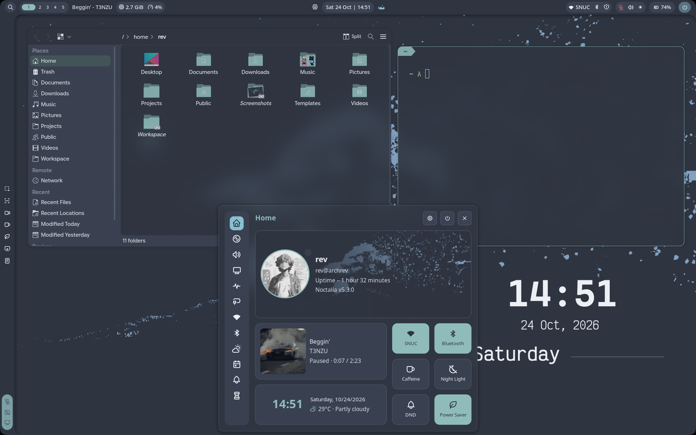

The `nord` profile uses a Nord palette with the current Noctalia theme settings.

### Black

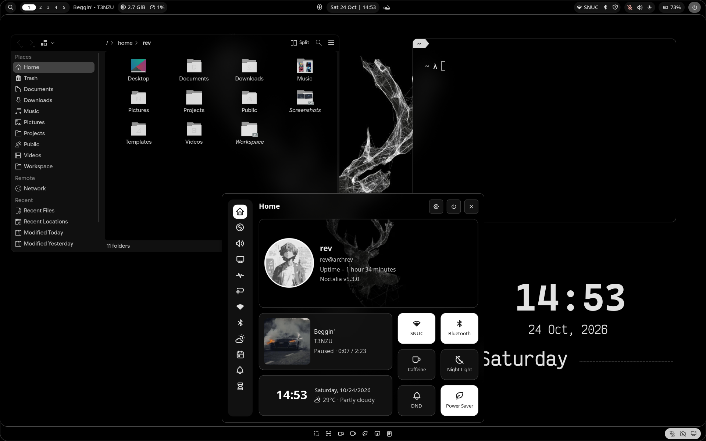

The `black` profile uses a black, monochrome look with wallpaper-derived colors and a white active window border.

### Switch profiles

```bash
~/.dotfiles/scripts/profile-switch          # open the profile picker
~/.dotfiles/scripts/profile-switch nord     # apply Nord directly
~/.dotfiles/scripts/profile-switch black    # apply Black directly
~/.dotfiles/scripts/profile-switch --list    # list available profiles
```

The profile switcher backs up the active settings, validates the selected configuration, updates `profiles/.current`, asks Noctalia to reload its templates, reloads Hyprland, and runs the profile hook when one exists. Backups are stored under `~/.local/state/hyprdots/backups/`.

The profile picker is also bound to `SUPER + ALT + SPACE`.

## Hyprland

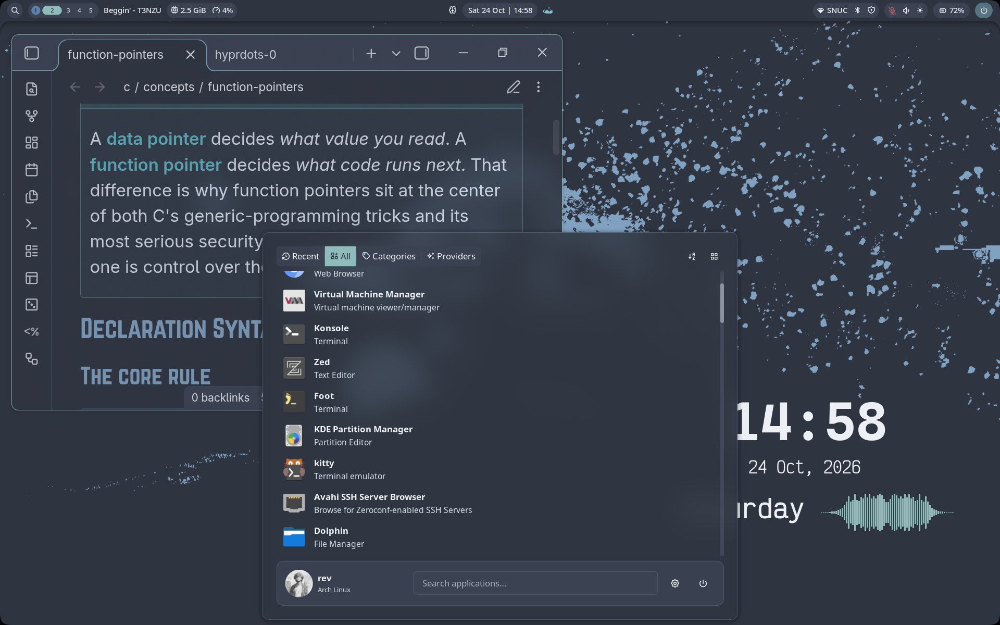

Hyprland is the core of this setup. The configuration is split into Lua modules for variables, keybindings, rules, input, decorations, animations, gestures, startup commands, and helper functions. The loader applies the base configuration first, then the files in `custom/` so local overrides stay separate from the defaults.

### Layout and workspace setup

- Dwindle is the default layout, with scrolling, master, and monocle available from the layout cycler.
- `F12` cycles layouts on the current workspace. `SUPER + SPACE` switches between scrolling and dwindle.
- Workspaces are arranged in groups of ten. `SUPER + 1..0` selects a workspace slot in the current group; `SUPER + CTRL + 1..0` selects the corresponding slot in another group.
- Special workspaces are used for general scratch space, the system monitor, and communication apps.
- Window groups act like tabs and can be cycled with `ALT + TAB`.
- Window rules handle floating dialogs, picture-in-picture, screen-sharing indicators, and application-specific sizing.

### Customize Hyprland

Do not edit files under `~/.config/hypr/hyprland/` for local changes. Put your changes in `~/.config/hypr/custom/`. Custom files return Lua tables that the loader merges with the base configuration.

>[!IMPORTANT]
>**Again NOTE,** do not edit the files under `~/.config/hypr/hyprland`, do not attempt to edit `~/.config/hypr/noctalia.lua` (as it is auto generated). For any further customizations, tweaks, or whatever, edit `~/.config/hypr/custom` only.

| File | Use |
| --- | --- |
| `custom/variables.lua` | Override variables such as opacity, gaps, rounding, apps, and keybindings. |
| `custom/keybinds.lua` | Add or replace keybindings. |
| `custom/functions.lua` | Define helper functions exposed as `fn.<name>`. |
| `custom/rules.lua` | Add window and workspace rules. |
| `custom/decoration.lua` | Override window decoration settings. |
| `custom/animations.lua` | Customize animation curves and animation rules. |
| `custom/input.lua` and `custom/gestures.lua` | Change input and gesture behavior. |
| `custom/execs.lua` | Add startup commands and event callbacks. |
| `custom/colors.lua` | Override border and color settings after Noctalia generates its theme. |

Example keybinding:

```lua
-- ~/.config/hypr/custom/keybinds.lua
return {
    fn.bind(
        "SUPER + ALT + T",
        hl.dsp.exec_cmd(vars.terminal .. " -e btop"),
        "Open system monitor"
    ),
}
```

Reload after changing the configuration:

```bash
hyprctl reload
hyprctl rollinglog
```

## Keybindings

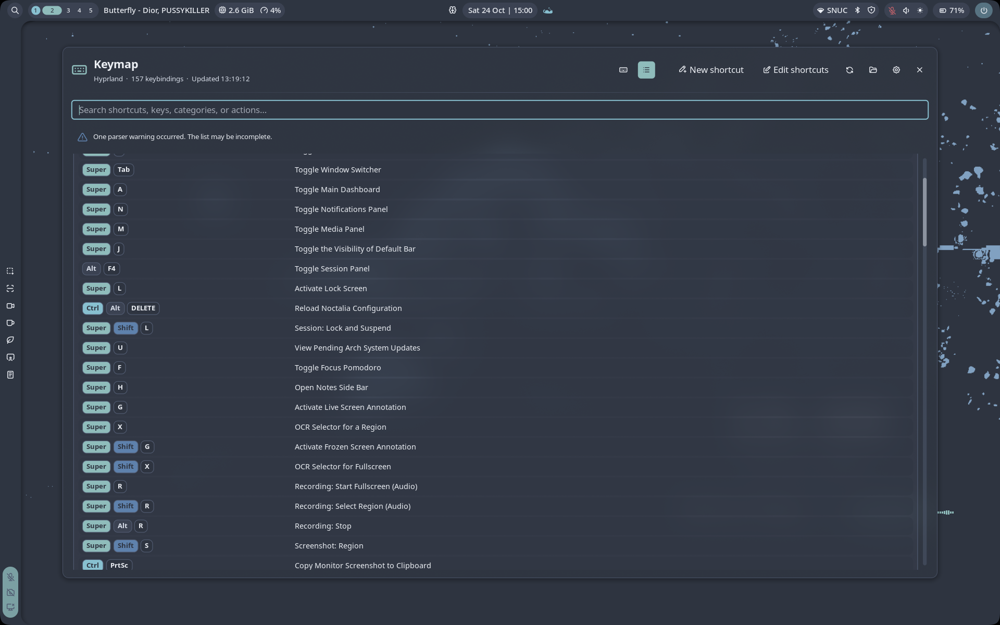

`SUPER` is the main modifier. The live cheatsheet is the most reliable reference because it is generated from the configured keybindings.

| Keys | Action |
| --- | --- |
| `SUPER` | Open launcher |
| `SUPER + RETURN` | Open Kitty |
| `SUPER + B` | Open Chromium |
| `SUPER + E` | Open Neovim in a terminal |
| `SUPER + T` | Open Dolphin |
| `SUPER + K` | Open keybinding cheatsheet |
| `SUPER + V` | Clipboard history |
| `SUPER + TAB` | Window switcher |
| `SUPER + W` | Wallpaper selector |
| `SUPER + ALT + SPACE` | Switch desktop profile |
| `SUPER + SHIFT + S` | Region screenshot |
| `SUPER + X` | OCR a selected region |
| `SUPER + G` | Live screen annotation |
| `SUPER + R` | Start screen recording |
| `SUPER + L` | Lock screen |
| `SUPER + Y` | Toggle system monitor workspace |
| `SUPER + SPACE` | Toggle scrolling and dwindle layouts |
| `F12` | Cycle layouts |

There are also bindings for moving and resizing windows, workspace groups, window tabs, media playback, volume, brightness, and power saving. Open the cheatsheet for the full list.

## Noctalia

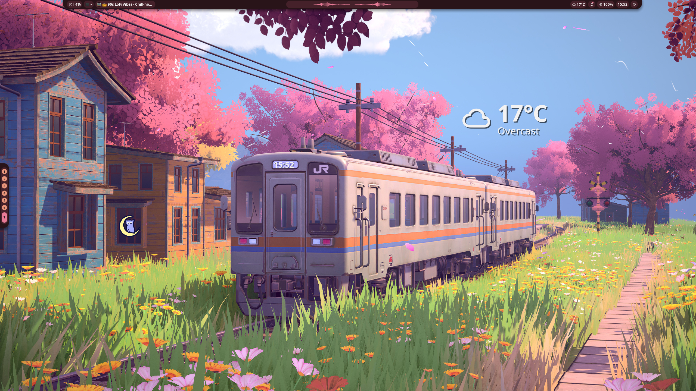

Noctalia provides the bar, launcher, control center, notifications, clipboard manager, lock screen, wallpaper controls, power menu, and desktop widgets. It also generates the colors used by many of the other applications in this repository.

The bar includes workspace and media widgets, system stats, tray icons, network and Bluetooth controls, battery status, and quick access to settings. Additional panels provide notes, a Pomodoro timer, OCR, region recording, a VPN manager, removable-media handling, and special-workspace indicators.

### Plugins

The plugins are enabled by `post-install.sh` after the first login.

| Plugin | Purpose |
| --- | --- |
| `dotnetrob/cat` | Bar mascot |
| `blackbartblues/keymap` | Keybinding cheatsheet |
| `thepunkoff/pomodoro` | Focus timer |
| `jamesfeeder/special-workspaces` | Special workspace indicator |
| `yuuto/arch-updater` | Pending Arch updates |
| `aristides/udiskie` | Removable media |
| `fel/ocr` | Screen text recognition |
| `h-jangra/region-recorder` | Screen recording |
| `andrewdems/vpn-manager` | NetworkManager and OpenVPN controls |
| `noctalia/notes` | Notes panel |

> [!WARNING]
> Noctalia plugins are third-party code running with your user privileges. The keymap plugin is marked deprecated upstream, so check its status before relying on it.

## Terminals

### Kitty

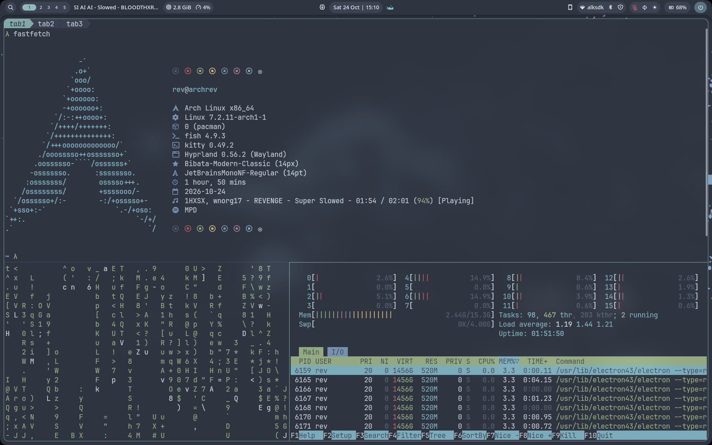

Kitty is my primary terminal. Its configuration includes a Noctalia-generated theme, Fish as the shell, tab and split layouts, and a search kitten.

Useful shortcuts include `ALT + ENTER` for a tab, `ALT + H` or `ALT + V` for splits, `ALT + arrow keys` to move between panes, and `CTRL + F` to search terminal output.

### Foot

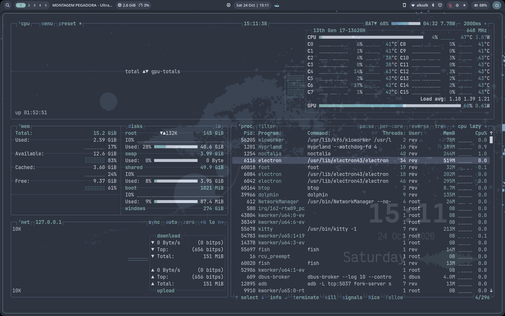

Foot is the lightweight alternative, with a matching theme, beam cursor, large scrollback buffer, and built-in search.

## Neovim

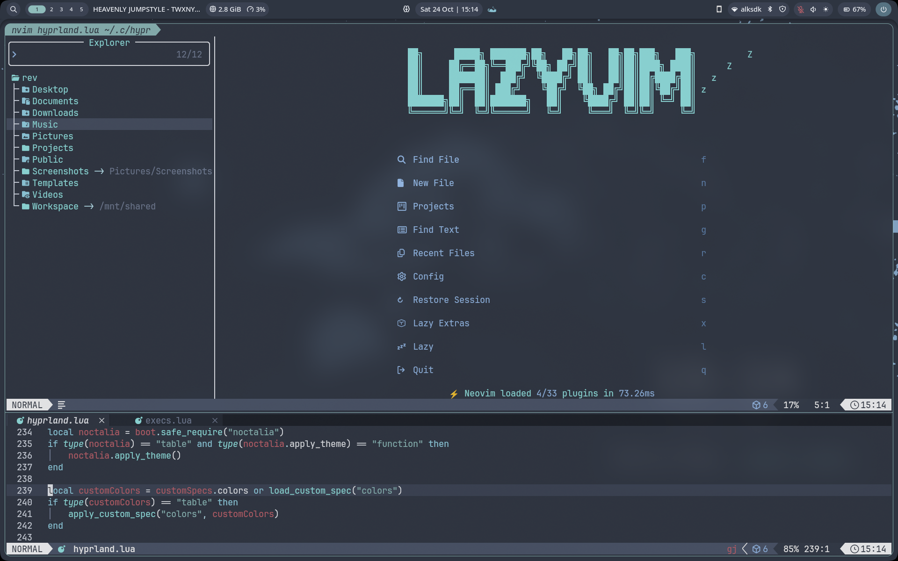

Neovim is configured with LazyVim and uses `Space` as the leader key. The theme follows the active Noctalia palette through a generated Base16 configuration. The setup includes LSP, formatting, Treesitter, search, navigation, and other standard editing tools.

Custom additions include `CTRL + S` to save, `CTRL + X` to quit, `CTRL + SHIFT + S` to save and quit, and `CTRL + SHIFT + X` to quit without saving. New C files use a C23 starter template, while `.s` and `.asm` files use an Intel-syntax x86 assembly template.

## Fish and Starship

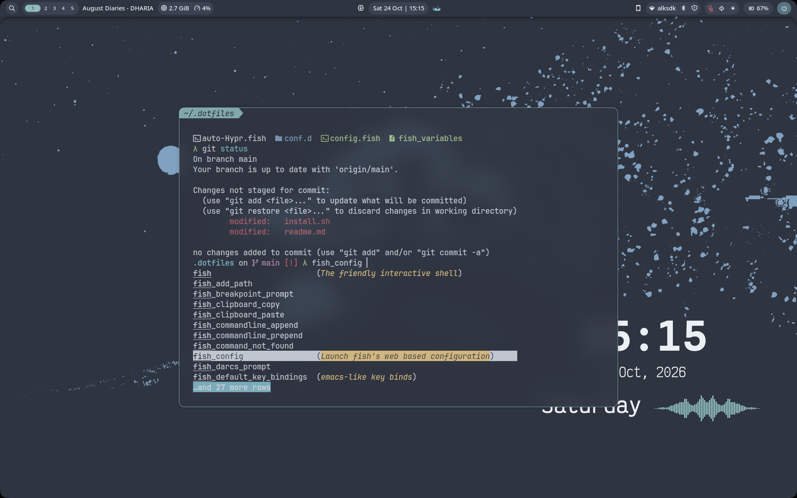

Fish is the login shell, with Starship for the prompt and a small collection of command-line tools. The setup includes eza, bat, fzf, zoxide, Git shortcuts, navigation aliases, and chezmoi helpers.

The installer can offer to make Fish the login shell. The TTY startup helper is stored separately as `auto-Hypr.fish`; if automatic startup does not trigger, source it from Fish startup configuration or launch `start-hyprland` manually.

## Music

### rmpc and MPD

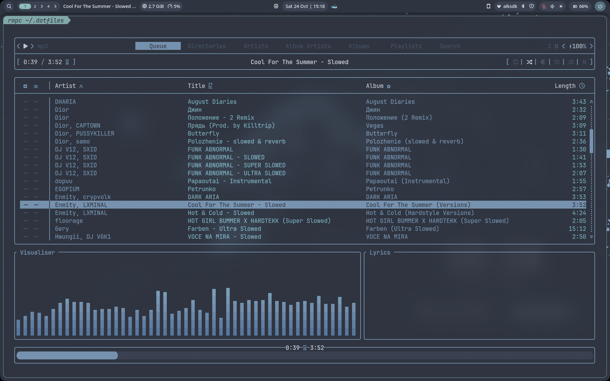

MPD provides playback, and rmpc is the terminal client. The configuration includes a Nord-style interface, album art, lyrics support, a CAVA visualizer, mouse support, and notifications when tracks change.

### CAVA

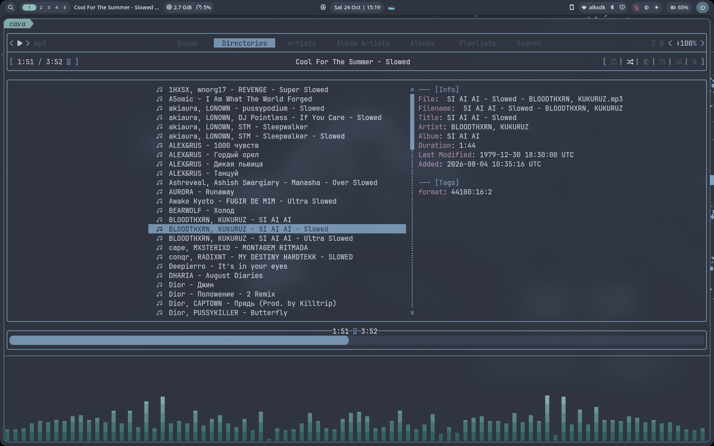

CAVA provides terminal audio visualization and includes several configuration themes and custom GLSL shaders.

> [!NOTE]
> MPD playback depends on a working audio setup and library configuration. Check the MPD user service and your music directory if the client opens but no tracks are available.

## Other tools

### Capture tools

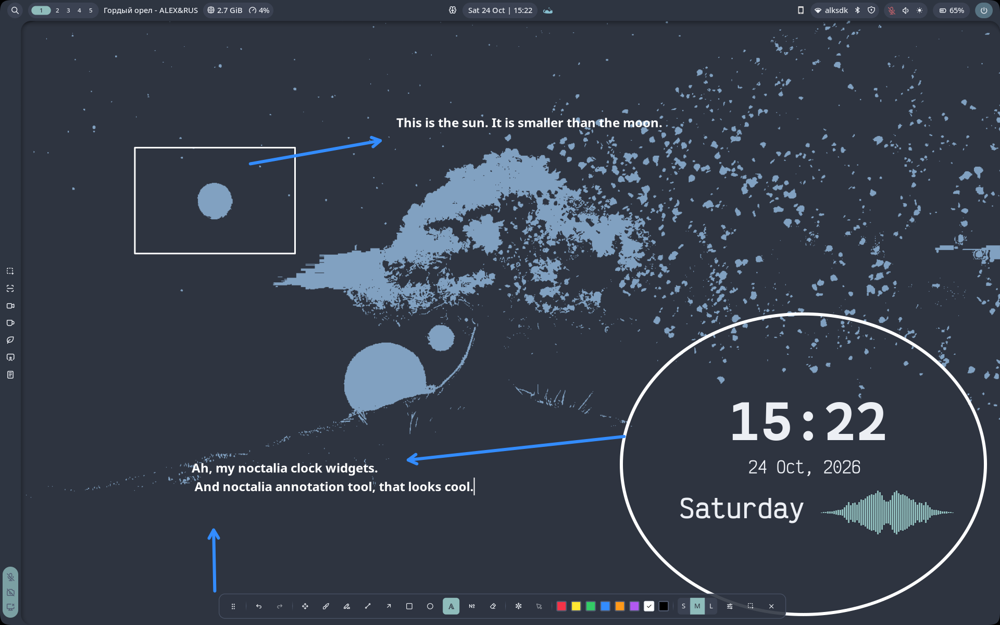

The capture workflow combines grim, slurp, swappy, gpu-screen-recorder, and Tesseract for screenshots, region selection, annotations, screen recording, and OCR. Screenshots are saved under `~/Pictures/Screenshots`, while recordings go to `~/Videos/Recordings`.

### Quick notes 

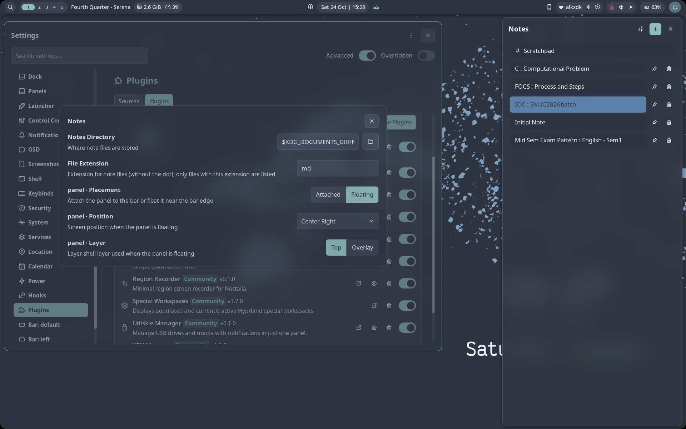

The Noctalia quick notes panel, spawned with the shortcut `SUPER + H`. Useful productivity tool, there exists a scratchpad. By default, the notes are stored in `~/Documents/Notes`. But the plugin also allows you to point the notes to other directories, such as your **Obsidian Vault**.
### File manager and browser

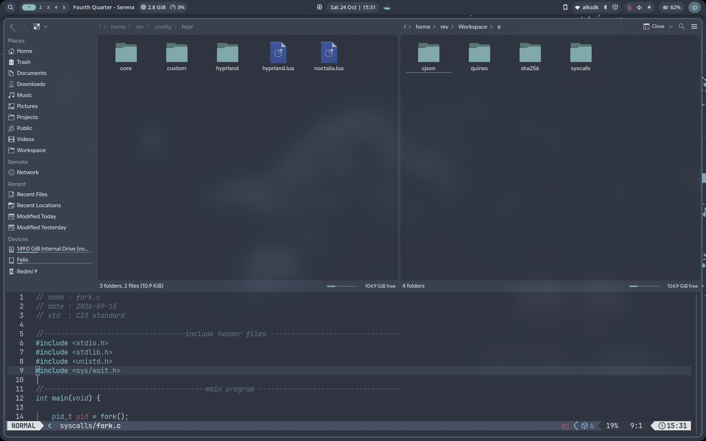

Dolphin is the configured file manager. With `konsole` installed, we can press f4 in the file manager to open a terminal in the directory.

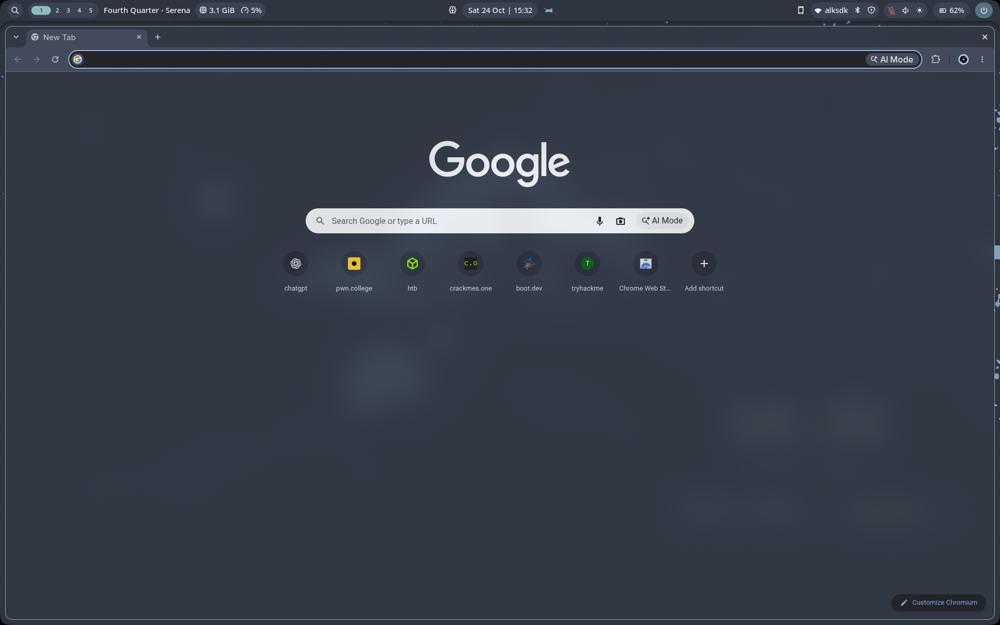

Chromium is the configured browser. Both application shortcuts are defined in the Hyprland keybindings.

## Dotfiles workflow

This repository uses chezmoi to manage the files deployed from `dots/` into your home directory. The `.chezmoiroot` file points chezmoi at that source tree. Prefixes such as `dot_`, `executable_`, and `private_` control names and file permissions.

Useful commands:

```bash
chezmoi diff       # preview changes
chezmoi apply      # apply repository changes
chezmoi status     # inspect managed-file status
chezmoi source-path
```

A typical edit cycle is:

```bash
$EDITOR ~/.config/hypr/custom/keybinds.lua
hyprctl reload
chezmoi add ~/.config/hypr/custom/keybinds.lua
git -C ~/.dotfiles add -A
git -C ~/.dotfiles commit -m "Update Hyprland keybindings"
```

Use `scripts/import-wallpapers.sh [source-directory]` to import additional wallpapers without replacing files already in the repository.

## Repository layout

```text
~/.dotfiles/
├── install.sh                 # Arch bootstrap and chezmoi setup
├── post-install.sh            # Enable Noctalia plugins after first login
├── packages/
│   ├── arch-desktop.txt       # Default pacman package manifest
│   └── aur-optional.txt       # Optional AUR appearance packages
├── profiles/
│   ├── .current               # Selected profile
│   ├── nord/                  # Nord Noctalia and Obsidian settings
│   └── black/                 # Black profile and optional hook
├── scripts/
│   ├── profile-switch         # Apply a profile
│   ├── profile-init           # Login profile hook
│   └── import-wallpapers.sh   # Import wallpapers
├── dots/                      # chezmoi source tree
│   ├── dot_config/hypr/       # Hyprland Lua config and overrides
│   ├── dot_config/noctalia/   # Noctalia support configuration
│   ├── dot_config/nvim/       # Neovim and LazyVim config
│   ├── dot_config/fish/       # Fish config and aliases
│   ├── dot_config/kitty/      # Kitty config
│   ├── dot_config/foot/       # Foot config
│   └── Pictures/Wallpapers/   # Wallpaper collection
└── assets/                    # README screenshots
```

## Troubleshooting

| Problem | What to check |
| --- | --- |
| Installer reports an unavailable package | Check the package name and enabled repositories in `packages/arch-desktop.txt`. The installer verifies package availability through pacman. |
| Hyprland does not start | Check `~/.cache/hyprland.log`. Confirm Hyprland is at least 0.55 and `~/.config/hypr/hyprland.lua` exists. |
| Hyprland starts without Noctalia | Run `noctalia config validate`, then launch `noctalia` from a terminal to inspect errors. |
| Noctalia plugins are missing | Start Noctalia, then rerun `~/.dotfiles/post-install.sh`. |
| Colors do not change after a profile switch | Rerun `~/.dotfiles/scripts/profile-switch PROFILE_NAME` and inspect `~/.local/state/hyprdots/` for logs and backups. |
| Fuzzel uses a fallback font | Install Google Sans Flex or change the configured font in `~/.config/fuzzel/fuzzel.ini`. |
| Network management behaves unexpectedly | The installer can enable NetworkManager. Avoid enabling it alongside an existing iwd or systemd-networkd setup unless you intend to migrate. |
| Apps keep asking for a keyring password | The setup starts GNOME Keyring but does not configure PAM to unlock it during a TTY login. Configure PAM deliberately or manage the keyring password with Seahorse. |

Useful diagnostics:

```bash
tail -f ~/.cache/hyprland.log
hyprctl rollinglog
noctalia config validate
noctalia msg plugins list
systemctl --user status mpd.service
```

## Security

> [!IMPORTANT]
> The installer, Hyprland startup commands, shell scripts, Noctalia plugins, and AUR packages execute with your user privileges. Read unfamiliar code before enabling it.

- Review `chezmoi diff` before applying the configuration.
- Review each AUR `PKGBUILD` before installing optional packages.
- Enable only the Noctalia plugins you actually use.
- Treat commands added to `custom/execs.lua` and keybindings as normal shell commands with your permissions.
- Keep backups outside the repository if you need protection against disk failure or accidental deletion. The installer archives replaced configuration files, but it is not a full system backup.

>[!NOTE]
>This readme file mostly contains the screenshots of the nord profile only. But the black profile also looks cool. You can try the black profile by pressing `SUPER + ALT + Space`, choose `black`. Black profile is fully functional and supported. You might have to change the theme of the chromium browser alone, as there is no template present for dynamic theme change in chromium.

**If you find any errors, discrepancies, please open an issue.**
If you have any suggestions, want to contribute, add profiles, you can make a pull request. 
If you like this dotfiles, give it a star, so that you can stay up to date with the changes made to this repository.

